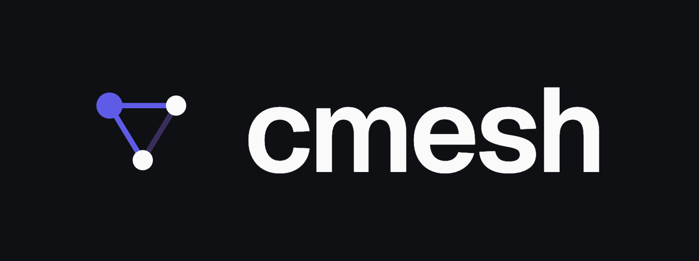

<p align="center">
  
</p>
<p align="center"><strong>Let your coding agent hand off work to a machine you control — without leaving your session.</strong></p>

cmesh gives the coding agent on your machine (Claude Code, Codex) a tool to delegate a scoped, policy-gated task to a coding agent on **another** machine you control, over a private Tailscale tailnet, and get a structured, auditable result back.

## What it does

You're on your Mac with Claude Code open, but the work belongs elsewhere: a Linux box for production-like builds, a Windows machine for native tests, a bare-metal server with the exact service state you need to inspect. If both machines are on your tailnet and the far one has a runner installed, cmesh turns that handoff into a single tool call your agent makes for you.

```text
Use cmesh to ask the datacenter server to inspect /srv/myapp and check why the deploy failed.
```

Your agent keeps running on your Mac. The work runs on the server. In testing, cmesh has run Linux builds, inspected services, and changed a Windows wallpaper — all driven from a Mac over the tailnet.

> <strong><font color="#0969da">Experimental - read this:</font></strong> cmesh causes real changes on real machines. **Do not use it on anything you love:** machines, repos, credentials, or data you cannot afford to lose. This is not enterprise remote management; it is an experimental agent delegation mesh for trusted private networks, and every worker profile is real authority on that machine. Start on trusted machines with narrow peer and cwd allowlists and the `query` profile. See [docs/security.md](docs/security.md).

## How the handoff works

1. Your local agent calls the cmesh MCP tool on loopback.
2. Your local daemon checks **outbound** policy and dispatches over Tailscale.
3. The worker daemon rejects any non-tailnet source.
4. It verifies the caller via Tailscale LocalAPI `whois` — Tailscale decides who is connected.
5. It checks **inbound** policy: allowed peer, cwd, profile, runner — cmesh decides what they may do.
6. It runs its local Claude Code / Codex runner and stores a durable, audited result.
7. Your agent polls status and fetches the result, treated as untrusted claims.

The MCP surface is never exposed to the network: the only endpoint is local loopback on the machine running the agent.

## Get started

Two things you do by hand. Everything else, you do by talking to your agent.

**1. Install the binary and register the MCP** (do this on each machine):

```bash
curl -fsSL https://raw.githubusercontent.com/somoore/cmesh/main/scripts/install.sh | sh
```

On Windows, run the PowerShell one-liner instead:

```powershell
powershell -NoProfile -ExecutionPolicy Bypass -Command "irm https://raw.githubusercontent.com/somoore/cmesh/main/scripts/install.ps1 | iex"
```

The installer detects your OS and CPU architecture, downloads the matching release archive, puts `cmesh` on PATH, and registers a stdio MCP entry in the agents it detects.

**2. Open a new agent session and say:**

```text
help me setup cmesh
```

From there the cmesh MCP wizard drives everything — detecting Tailscale and peers, writing config after you confirm, starting the daemon, and walking the two-machine handshake. To add a second machine, install cmesh there and say `continue helping me configure cmesh for this new node`. Full instructions, profiles, and example prompts live in [docs/quickstart.md](docs/quickstart.md).

## Documentation

| Doc | What's inside |
| --- | --- |
| [Why cmesh?](docs/why-cmesh.md) | The latest thesis for cmesh over SSH plus tmux |
| [Concepts](docs/concepts.md) | What cmesh is, why it exists, and the mental models |
| [Quickstart](docs/quickstart.md) | Install, setup wizard, two-machine handshake |
| [Architecture](docs/architecture.md) | Surfaces, request lifecycle, trust boundaries, data model |
| [Commands](docs/commands.md) | The `cmesh` CLI surface |
| [MCP tools](docs/mcp-tools.md) | Delegation tools your agent calls |
| [MCP onboarding tools](docs/mcp-onboarding.md) | The setup-wizard tool surface |
| [Configuration](docs/configuration.md) | `config.toml` reference |
| [Security model](docs/security.md) | Threat model, defense in depth, hardening |
| [Delegation guidance](docs/delegation-guidance.md) | Writing good tasks and reading results |
| [Runner manifests](docs/runner-manifests.md) | How runners declare capabilities |
| [Tailscale grants](docs/tailscale-grants.md) | Restricting mesh reachability |
| [Teams plan](docs/teams-plan.md) | How cmesh gets to multi-agent teams, and the model behind it |
| [Roadmap](ROADMAP.md) | Planned hardening and intentional non-goals |
| [Contributing](CONTRIBUTING.md) | Local checks and contribution expectations |
| [Release](docs/release.md) | Release process |
| [Development](docs/development.md) | Building and contributing |

## Project shape

```text
cmd/cmesh    CLI and daemon entrypoint
internal/    daemon, policy, store, runner, and RPC packages
schemas/     JSON Schemas
examples/    runnable config and Tailscale grant examples
docs/        architecture and operator guidance
```

## Uninstall

```bash
cmesh uninstall
```

It mirrors the installer — removing the MCP is the core action; anything else is separately consented. Details in [docs/quickstart.md](docs/quickstart.md).

## License

cmesh is licensed under the [Apache License 2.0](LICENSE).
