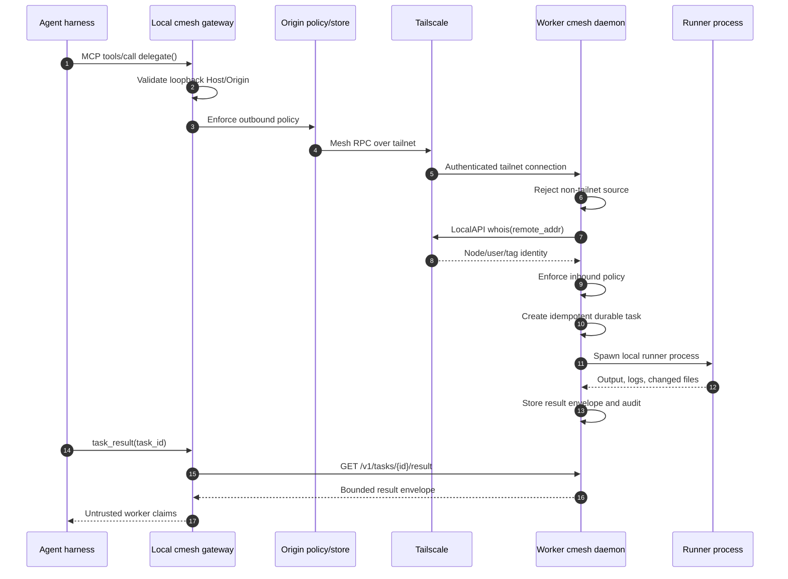
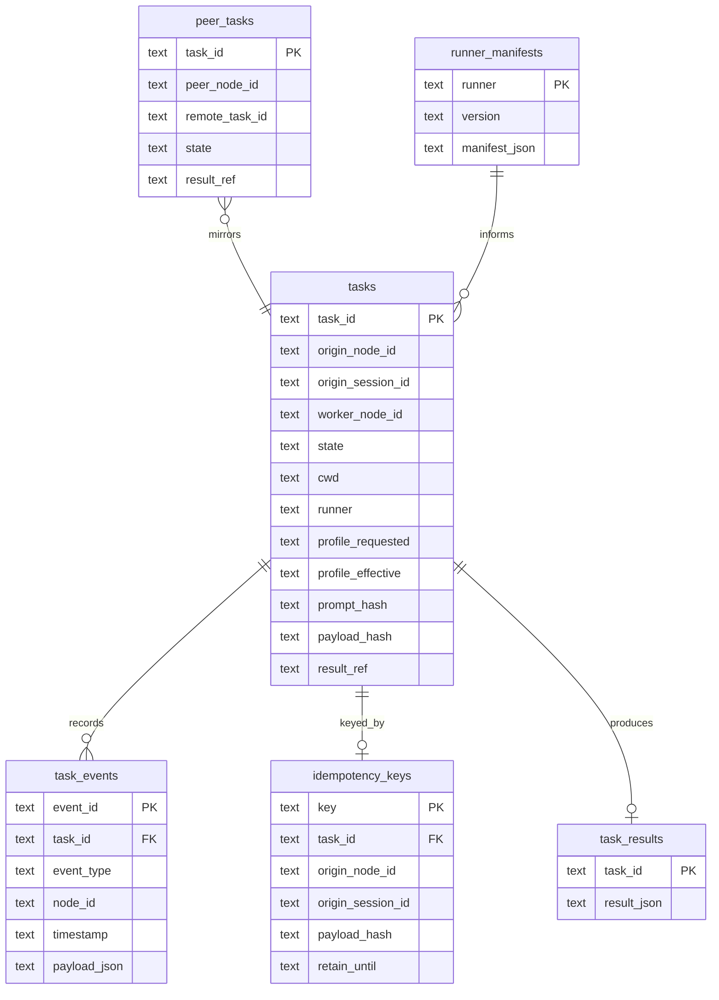

# Architecture

> Experimental: this architecture describes an early agent delegation mesh for trusted private networks. It is not a claim of enterprise hardening, and every worker profile should be treated as real authority on that machine.

cmesh is a local-first delegation plane for coding agents. It separates the model-facing tool surface from the daemon-to-daemon transport so remote machines can execute work without exposing MCP over the network.

There are two MCP surfaces:

- `cmesh mcp --stdio`: setup MCP launched directly by an AI coding agent before the daemon exists. It discovers Tailscale/runners/peers, suggests config, validates config, and writes config only after explicit confirmation.
- `http://127.0.0.1:7777/mcp`: local HTTP gateway served by `cmesh up` after setup. This is the delegation surface agents use for tasks.

## End-to-end diagram

```mermaid
flowchart LR
  subgraph Origin["Origin machine: mac-studio"]
    Agent["Agent harness<br/>Claude Code / Codex / other"]
    SetupMCP["setup MCP<br/>cmesh mcp --stdio<br/>pre-daemon onboarding"]
    MCP["cmesh local MCP gateway<br/>127.0.0.1:7777/mcp"]
    OP["Outbound policy<br/>peer/profile/hop checks"]
    OStore["SQLite task mirror<br/>peer_tasks, events"]
    OAudit["audit.jsonl"]
  end

  subgraph Tailnet["Tailscale tailnet"]
    RPC["Mesh RPC<br/>HTTP+JSON v1<br/>schema-versioned<br/>idempotent"]
    Whois["tailscaled LocalAPI<br/>whois(remote_addr)"]
  end

  subgraph Worker["Worker machine: homelab-vm"]
    Mesh["cmesh mesh RPC server<br/>100.x.y.z:7778"]
    IP["Tailnet source check"]
    Identity["Identity resolution<br/>node/user/tags"]
    WP["Inbound policy<br/>allowed peer<br/>realpath cwd<br/>profile ceiling<br/>runner availability"]
    WStore["SQLite durable store<br/>tasks, idempotency_keys,<br/>task_events, runner_manifests"]
    WAudit["audit.jsonl"]
    Git["Git contract<br/>clean worktree check<br/>cmesh/task branch<br/>local commit + footers"]
    Runner["Runner adapter<br/>Claude Code / Codex"]
    Proc["Worker process group<br/>captured stdout/stderr<br/>transcript refs"]
    Result["Canonical result envelope<br/>command_output artifact<br/>worker_summary_untrusted<br/>diffstat, files, tests,<br/>verification_required"]
  end

  Agent -. "first-run setup" .-> SetupMCP
  SetupMCP -. "writes config after confirmation" .-> MCP
  Agent -->|"tools/list, tools/call"| MCP
  MCP --> OP
  OP -->|"task.dispatch.requested"| OAudit
  OP --> OStore
  OP -->|"POST /v1/tasks"| RPC
  RPC --> Mesh
  Mesh --> IP
  IP --> Whois
  Whois --> Identity
  Identity --> WP
  WP -->|"denied"| WAudit
  WP -->|"accepted"| WStore
  WStore --> WAudit
  WP --> Git
  Git --> Runner
  Runner --> Proc
  Proc --> Result
  Result --> WStore
  Result --> WAudit
  Agent -->|"task_status / task_result"| MCP
  MCP -->|"GET /v1/tasks/{id}<br/>GET /v1/tasks/{id}/result"| RPC
  RPC --> WStore
  WStore --> Result
  Result --> MCP
  MCP --> Agent
```

## Request lifecycle

Onboarding is wizard-driven. The two MCP surfaces are split by daemon start: the stdio setup MCP (`cmesh mcp --stdio`, installed into Claude Code or Codex before the daemon exists, no network listener) runs first-run setup, and the local HTTP gateway (`http://127.0.0.1:7777/mcp`, served by `cmesh up`) runs delegation afterward. The stdio setup server is a stateless onboarding wizard: it re-derives where setup stands from the environment on every call (verify, don't ask), confirms before each state change, and is therefore resumable and safe to re-run. It detects Tailscale and peers, writes config, installs and starts the daemon, registers the gateway, and walks the two-machine handshake — where each machine independently configures itself to trust and reach the other rather than resuming a shared session. Once it brings the daemon up, the agent's cmesh MCP moves from this stdio setup server to the HTTP gateway below.

Once `cmesh up` is running:

1. The agent calls the local MCP tool, usually `delegate`.
2. The loopback gateway validates local HTTP hardening rules:
   - loopback host only;
   - loopback origin only;
   - no forwarded identity headers.
3. The origin daemon applies outbound policy.
4. The origin daemon writes an audit event and mirrors the peer task locally.
5. The origin daemon sends `POST /v1/tasks` to the configured peer over Tailscale.
6. The worker daemon rejects non-tailnet sources before policy evaluation.
7. The worker daemon asks Tailscale LocalAPI `whois` for the inbound peer identity.
8. The worker daemon validates that request provenance is consistent with the whois-derived peer identity. Direct first-hop requests must identify the authenticated peer as origin; subdelegation requests must name the authenticated peer as the last hop in the delegation chain.
9. The worker daemon applies inbound policy:
   - allowed peer;
   - hop limit;
   - cycle detection;
   - realpath-normalized cwd allowlist;
   - configured profile;
   - configured runner.
10. The worker daemon creates or replays the task through the idempotency table.
11. The worker daemon prepares the git contract:
    - refuse dirty worktrees unless `allow_dirty=true`;
    - create deterministic `cmesh/<task-id>/<slug>` branch;
    - commit with cmesh metadata footers after runner execution.
12. The runner adapter launches the local worker process with captured logs. The task prompt is supplied on stdin by default; argv prompt delivery is not the runner contract.
13. The worker stores a bounded canonical result envelope. `command_output` contains the redacted command, raw stdout, raw stderr, exit code, duration, and log refs. `worker_summary_untrusted` is presentation-only text.
14. The origin agent polls `task_status` and fetches `task_result`. While the task runs it can also poll `task_events` for recorded progress — state transitions, policy decisions, dispatch — reading incrementally with a `seq` cursor rather than refetching history. Those events are written by the daemon, so unlike the worker's summary they are evidence rather than claims.
15. A running task can also talk to its owner over the **task channel**: `task_post` for progress and `task_ask` for a question, both from inside the worker, answered by the origin with `task_send`. A question moves the task to `awaiting_input` until it is answered or the worker proceeds. The two ends take different credentials — the worker end authenticates with its per-task token, the origin end with task ownership — so a worker cannot answer its own question. See [Security](security.md).

Task status, result, transcript, artifact, cancel, and list operations are task-owner scoped. The original origin may read its tasks, and an intermediate worker may read the downstream task it directly created during subdelegation; unrelated peers cannot enumerate or operate on those tasks.

`cmesh up` runs a local preflight before binding the mesh listener. The preflight checks configured runner profiles and performs a local smoke round-trip through each runner. A daemon that cannot resolve/authenticate a runner, cannot feed prompts over stdin, or cannot verify the smoke response from the raw `command_output` artifact fails before advertising itself as reachable.

Fan-out delegation is represented as a peer-keyed map of ordinary single-peer dispatches. Each peer gets its own task id, durable state, and result envelope; aggregation never merges worker prose across machines.

Session continuity is opt-in. A normal task launches a fresh runner process and produces an auditable envelope. A follow-up task can name `followup_task_id`; cmesh keeps that continuation on the same peer, uses the previous head commit as the base, and passes a runner session id only when the previous result exposed one.

## Trust boundaries

The important split:

- Tailscale decides who is connected.
- cmesh policy decides what that peer may do.
- The runner decides how a local agent process is invoked.
- Git remains the artifact transport.

## Data model

## Failure semantics

cmesh is async-first and durable. Once `delegate` returns a task id, later sessions can query the task.

Worker daemon restart is fail-closed in v1:

- queued/running tasks are marked `failed`;
- error code is `worker_daemon_restarted`;
- audit records the transition;
- silent task loss is forbidden.

Origin restart reloads mirrored peer tasks from SQLite and continues polling the worker.

## See also

- [Security](security.md) — the trust boundary, defense-in-depth layers, and threat model behind this design.
- [Configuration](configuration.md) — the config fields that drive policy, profiles, peers, and the two ports shown above.
- [Delegation guidance](delegation-guidance.md) — the model-facing rules for when and how an agent uses the delegation surface.
