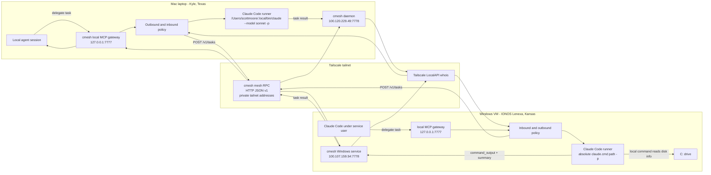

# Real-world testing: Mac in Texas to Windows in Kansas

This document records an end-to-end cmesh test between two physically separate machines:

- Mac laptop in Kyle, Texas
- Windows VM running on a bare-metal server in an IONOS datacenter in Lenexa, Kansas

The goal was not a synthetic localhost demo. The goal was to prove that one endpoint can delegate a real task to the other endpoint over a private mesh, have the remote machine run its local agent in the right service/user context, and return useful machine-specific information.

The concrete use case tested here was:

```text
Ask the Windows endpoint to report remaining disk space on its C: drive.
```

The final verified result from Windows was:

```text
Total GB:    99.02
Free GB:     48.70
Used GB:     50.33
Percent free: 49.2%
```

The disk-space task was dispatched from the Mac to the Windows service through cmesh only.

## What was proven

cmesh successfully handled two-way delegation:

- Windows to Mac: Windows service delegated a smoke task to the Mac endpoint and verified the Mac runner received the prompt.
- Mac to Windows: Mac delegated a smoke task to the Windows service and verified the Windows runner received the prompt.
- Mac to Windows real task: Mac asked Windows for C: drive disk space and received a structured result with a raw `command_output` artifact.
- Mac to Windows restart task: Mac delegated a long-running Windows task, the Windows service restarted mid-task, and cmesh marked the task failed with `worker_daemon_restarted` instead of silently losing it.

The important part is not just that the task returned `done`. We fixed the smoke test so it verifies that the remote runner actually received and answered the prompt. A remote task is only considered healthy when the worker response contains the expected smoke value:

```text
cmesh smoke ok
```

That distinction mattered because one failure mode returned exit code 0 while Claude said it had not received a task.

## Architecture



## How it works end to end

1. Each machine runs `cmesh up`.
2. Each daemon listens on its Tailscale address for peer RPC:
   - Mac: `100.120.229.49:7778`
   - Windows: `100.107.159.54:7778`
3. Each machine also exposes a local-only MCP gateway on `127.0.0.1:7777`.
4. A local agent asks cmesh to delegate a task to a configured peer.
5. The origin daemon checks outbound policy.
6. The origin daemon sends `POST /v1/tasks` to the peer over the tailnet.
7. The worker daemon verifies the caller through Tailscale identity and cmesh inbound policy.
8. The worker daemon launches the configured local runner.
9. The runner receives the prompt over stdin.
10. The worker stores the task result and transcript references.
11. The origin fetches task status and task result.

cmesh is task-driven. It is not continuously streaming machine data between endpoints. Traffic happens when a task is submitted, status/result is fetched, or another explicit cmesh request is made.

## Commands used to validate the loop

From the Mac to test the Windows endpoint:

```bash
./cmesh peers test win11-desktop --cwd 'C:\Users\scott\code\cmesh' --timeout 45
```

Final passing result:

```text
cmesh test

peer reachable           ok  win11-desktop
inbound policy allowed   ok  done
task id                  ok  tsk_fxkxhromqjxlvua5uzy376y6f2ugyk4q
task completed           ok  done
smoke response verified  ok  cmesh smoke ok
```

From Windows to test the Mac endpoint:

```powershell
.\cmesh.exe peers test scotts-macbook-pro --cwd "/Users/scottmoore/github/cmesh" --timeout 30
```

Final passing result reported from Windows:

```text
peer reachable           ok  scotts-macbook-pro
inbound policy allowed   ok  done
task id                  ok  tsk_j7y6tlah5xbv6taxvhoi3zjcn3odal76
task completed           ok  done
smoke response verified  ok  cmesh smoke ok
```

Mac-to-Windows real task for C: drive space.

The following Python request was a low-level validation probe from the original test. It intentionally called the worker mesh RPC endpoint directly to isolate transport and worker behavior. It is not the canonical product flow for agents or users. Normal delegation should go through the local MCP gateway so origin-side outbound policy, provenance, task-token handling, idempotency, and local task mirrors are applied before the worker sees the request.

Canonical gateway shape for the same task:

```json
{
  "tool": "delegate",
  "arguments": {
    "peer": "win11-desktop",
    "prompt": "On this Windows machine, run a local command to report C: drive disk space. Return only: total GB, free GB, used GB, and percent free. Include the exact command names used and do not edit files.",
    "cwd": "C:\\Users\\scott\\code\\cmesh",
    "profile": "readonly",
    "timeout_s": 60,
    "wait": true,
    "idempotency_key": "disk-check-win11-c"
  }
}
```

Low-level direct RPC probe used during the initial validation:

```bash
python3 - <<'PY'
import json, urllib.request

payload = {
    "origin_node_id": "nodeid:3533557192178852",
    "origin_session_id": "cmesh-cli-disk-check",
    "prompt": "On this Windows machine, run a local command to report C: drive disk space. Return only: total GB, free GB, used GB, and percent free. Do not edit files.",
    "cwd": "C:\\Users\\scott\\code\\cmesh",
    "profile": "readonly",
    "timeout_s": 60,
    "wait": True,
    "provenance": {
        "origin_node_id": "nodeid:3533557192178852",
        "origin_session_id": "cmesh-cli-disk-check",
        "delegation_chain": ["nodeid:3533557192178852"],
        "hop_count": 0
    }
}

req = urllib.request.Request(
    "http://100.107.159.54:7778/v1/tasks",
    data=json.dumps(payload).encode(),
    headers={"Content-Type": "application/json", "Cmesh-Schema-Version": "v1"},
    method="POST",
)

with urllib.request.urlopen(req, timeout=75) as resp:
    print(resp.read().decode())
PY
```

Task response:

```json
{"task_id":"tsk_orjlwkor6hv4yicnfbghdnwbxc7iei7d","state":"done","replayed":false}
```

Result fetch:

```bash
curl -fsS --max-time 10 \
  http://100.107.159.54:7778/v1/tasks/tsk_orjlwkor6hv4yicnfbghdnwbxc7iei7d/result | jq .
```

Worker summary:

```text
C: drive disk space:

- Total GB: 99.02
- Free GB: 48.70
- Used GB: 50.33
- Percent free: 49.2%
```

## Issues found and fixed

This test surfaced several real operational problems.

### 1. Mac endpoint was not reachable from Windows

Windows initially could not connect to the Mac cmesh mesh endpoint on `100.120.229.49:7778`.

The failure looked like a peer/network issue, but the useful framing was:

```text
Can Windows reach the Mac cmesh daemon's tailnet listener?
```

The Mac-side service/start and firewall path was corrected. After that, Windows could reach the Mac daemon and start tasks.

### 2. Mac runner profile and repo state blocked execution

After reachability was fixed, the Windows-to-Mac task hit Mac-side execution blockers:

- `readonly` profile was unavailable in the Mac runner configuration.
- `dev` profile was blocked by a dirty worktree.

The Mac config and local repo state were corrected so a peer task could run under a working profile.

### 3. Mac Claude model setting was invalid

The Mac runner selected a model value that Claude Code could not access:

```text
claude-fable-5
```

The Mac runner command was changed to a known working model:

```toml
[runners.claude-code]
command = ["/Users/scottmoore/.local/bin/claude", "--model", "sonnet", "-p"]
```

### 4. Windows service did not inherit interactive runner auth

The Windows foreground daemon worked because it inherited the interactive user's Claude auth and PATH. The Windows service path was different: LocalSystem did not have the same Claude Code credentials or npm PATH.

The fix was to support installing the Windows service under the same authenticated user:

```powershell
.\cmesh.exe up service install --user ".\scott" --prompt-password
.\cmesh.exe up service start
```

The Windows runner command also stayed absolute:

```toml
[runners.claude-code]
command = ["C:\\Users\\scott\\AppData\\Roaming\\npm\\claude.cmd", "-p"]
```

This made the service behave like the successful foreground daemon while still running as a managed Windows service.

### 5. Windows `claude.cmd` did not receive prompt arguments reliably

Mac-to-Windows tasks reached the Windows service and exited successfully, but Claude responded as if no prompt had been supplied:

```text
I don't see a task in your message yet...
```

The root cause was that cmesh appended the prompt as a command-line argument. On Windows, the `claude.cmd` wrapper could lose or ignore that multi-line argument.

The fix was to send the runner prompt over stdin instead of argv.

This changed the runner invocation from conceptually:

```text
claude.cmd -p ... <prompt-as-argument>
```

to:

```text
claude.cmd -p ...
# prompt supplied on stdin
```

That is more robust across shell wrappers and avoids command-line escaping problems.

### 6. The smoke test accepted false positives

Before the final fix, `cmesh peers test` considered a task successful when the task exited with state `done`. That was not strong enough. A task could exit 0 while the worker said it never received a task.

The smoke test now sends:

```text
Reply with exactly: cmesh smoke ok
```

and verifies the result contains:

```text
cmesh smoke ok
```

If the runner returns a generic "what should I do?" response, the smoke test fails.

## Why this may be bigger than the original thesis

The original cmesh thesis was agent delegation across machines: let the coding agent on one machine ask the coding agent on another machine to do work.

This real-world test showed something broader:

```text
cmesh can be a private, task-driven operations fabric for machines you control.
```

That overlaps with some of the value people get from tools like Fleet or osquery, but with a different operating model.

Fleet and osquery are strong at continuous fleet inventory, predefined structured queries, compliance checks, and scheduled telemetry. cmesh is not that. cmesh is task-driven delegation:

- Ask a live question of a specific machine.
- Run in the real local context of that machine.
- Use the local authenticated agent and toolchain.
- Apply peer policy before execution.
- Keep task IDs, transcripts, result envelopes, and audit trails.
- Return a result to the originating agent session.

That distinction is important. cmesh does not need to become a continuous telemetry platform to be useful. It can be valuable because it lets a human or agent ask:

```text
Check that Windows machine in the datacenter and tell me how much C: drive space is left.
```

and get an answer without switching machines, opening public ingress, manually SSHing, copying prompts, or installing a heavy control plane.

The same primitive generalizes:

- Ask a Windows box to run native tests.
- Ask a Mac to inspect an Apple build.
- Ask a Linux server to summarize service logs.
- Ask a VM to check disk, memory, packages, ports, or repo state.
- Ask a remote machine to make a scoped change and return the branch/result.

The important product boundary is still clear:

- cmesh is not silently collecting everything.
- cmesh is not exposing MCP across the public internet.
- cmesh is not replacing structured fleet telemetry.
- cmesh is a policy-gated way to delegate a specific task to a specific machine over a private mesh.

That makes the primitive feel larger than "agent-to-agent coding handoff." It is remote machine collaboration with agent-native ergonomics.

## Restart semantics evidence

The real Mac-to-Windows topology also exercised worker daemon restart behavior. A deterministic long-running Windows task was started from the Mac and the Windows service was restarted while the task was running.

Observed task:

```text
task_id: tsk_rjmfzb7rgg7jok6pxpk2e2omk3dzswe7
state: failed
terminal_error_code: worker_daemon_restarted
```

The Windows audit log recorded:

```text
type: task.failed
policy_decision: fail_closed_restart
error_code: worker_daemon_restarted
```

No result envelope was available afterward, which is expected for a worker process interrupted before result production. The important guarantee was preserved: the task became terminal and auditable rather than disappearing or being reported as successful.

## Final state

At the end of this test:

- Mac-to-Windows smoke test passed with prompt verification from raw `command_output`.
- Windows-to-Mac smoke test passed with prompt verification from raw `command_output`.
- Windows service ran as `.\scott`.
- Windows service used the absolute `claude.cmd` runner path.
- Windows service was reachable on `100.107.159.54:7778`.
- Mac service was reachable on `100.120.229.49:7778`.
- The Windows C: drive disk-space task completed through cmesh only.
- Worker daemon restart marked the interrupted Windows task `failed` with `worker_daemon_restarted`.
- The repo branch was clean on `mcp-registration-peering` after the strict-smoke verification.
