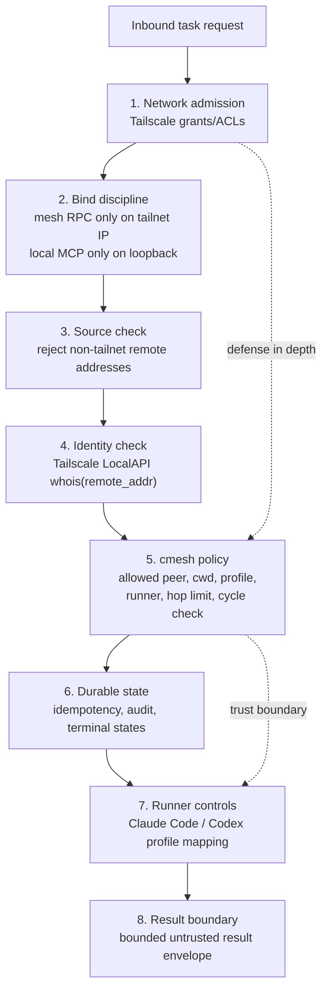

# Security

cmesh is designed to be safe for personal and small-team tailnets when it is configured correctly. It does not rely on "the network can reach me" as permission to run code. Network reachability is only the first gate.

Short version:

- You provide trusted machines, Tailscale, and local runner credentials.
- Tailscale provides encrypted transport and authenticated peer identity.
- cmesh decides whether that peer may run this task, in this directory, with this profile.
- Worker output is treated as untrusted claims, not truth.

cmesh is not a sandbox by itself. It is a policy and delegation layer around local agent runners. The selected runner and operating system still matter.

## Defense in depth



The important line is between identity and authorization:

- Tailscale tells cmesh who connected.
- cmesh policy decides what that peer may do.

## How cmesh rejects illegitimate nodes

An illegitimate node can mean several different things. cmesh handles each layer differently.

### A machine not on your tailnet

It should not be able to reach the mesh port at all. Mesh RPC binds to the node's Tailscale IP, not `0.0.0.0`, and `cmesh doctor tailscale` verifies that bind behavior.

### A tailnet machine without cmesh permission

Even if Tailscale grants allow the connection, the worker daemon still calls Tailscale LocalAPI `whois(remote_addr)` and compares the resolved node identity against cmesh policy.

Example:

```toml
[policy]
allowed_peers = ["mac-studio"]
allowed_cwds = ["~/code/**"]
hop_limit = 2
```

If `random-laptop` is on the tailnet but not in `allowed_peers`, the task is denied before any runner starts.

### A request with forged identity headers

cmesh does not trust identity headers. The loopback gateway rejects forwarded identity headers, and mesh RPC identity comes from Tailscale LocalAPI, not from `X-Forwarded-*`, bearer tokens, or request JSON.

### A worker trying to forge delegation provenance

Subdelegation provenance is derived from a per-task token, not from model-supplied chain fields. When a worker task starts, cmesh writes a local task context, exposes a task token to that runner as `CMESH_TASK_TOKEN`, and writes a task-scoped MCP config with `Authorization: Bearer <task-token>`. The Claude Code runner loads that file with `--mcp-config` and `--strict-mcp-config`, so MCP calls from the worker carry the token structurally even when the gateway requires `host_token`.

Legacy provenance fields such as `origin_node_id`, `delegation_chain`, and `hop_count` are treated as compatibility hints only. They are ignored when a task token is present, and they are not authoritative for subdelegation policy. A local request without a valid task token is treated as a fresh local origin and does not inherit worker provenance.

### A valid peer asking for too much

A legitimate peer can still be denied. cmesh checks:

- peer identity;
- realpath-normalized cwd allowlist;
- requested profile;
- effective profile ceiling;
- runner availability;
- token-backed hop limit;
- token-backed cycle detection.

If any check fails, the task reaches a queryable terminal state such as `denied` or `failed`.

## What cmesh protects

cmesh protects the delegation boundary:

- who may ask this node to do work;
- where the work may run;
- which runner/profile may be used;
- whether a replayed request is identical or conflicting;
- whether every task has a durable state;
- whether every dispatch, denial, result, and failure is auditable.
- whether subdelegation provenance is derived from stored task context instead of worker claims.

It also avoids common footguns:

- no remote MCP surface;
- no public internet listener;
- no daemon-to-daemon bearer token in Tailscale mode;
- no trust in forwarded identity headers;
- no silent task loss on restart;
- no automatic inlining of full transcripts into agent context;
- no long-lived task token after the worker reaches a terminal state.

## What cmesh does not protect by itself

cmesh is not a complete containment system.

It does not replace:

- Tailscale account security;
- operating system user separation;
- filesystem permissions;
- runner-specific sandboxing;
- secrets management;
- repository review;
- human judgment for risky changes.

If an allowed peer is compromised, cmesh can restrict the directories and profiles it may use, but it cannot make that peer trustworthy. Treat allowed peers as trusted-but-constrained machines.

## Is cmesh secure to use?

For a personal tailnet or trusted small-team tailnet, cmesh is designed to be reasonable to use when:

- mesh RPC binds only to the Tailscale IP;
- local MCP binds only to loopback;
- Tailscale LocalAPI works for the daemon user;
- `allowed_peers` is narrow;
- `allowed_cwds` is narrow;
- exposed profiles are conservative;
- risky profiles are used only on disposable or snapshot-protected machines;
- runner credentials are scoped appropriately;
- high-risk worker results are verified locally.

For production or team-wide use, treat cmesh as security-sensitive infrastructure. Review policy, audit logs, runner manifests, OS permissions, and Tailscale grants before allowing broad access.

## Recommended hardening

### Tailscale

- Use Tailscale grants or ACLs to limit mesh RPC reachability to cmesh nodes.
- Prefer tagged devices for daemon nodes.
- Do not expose mesh RPC through Funnel, Serve, cloudflared, nginx, or a public load balancer.
- Run `cmesh doctor tailscale` under the same account or service user that runs cmesh.

### cmesh config

- Keep `allowed_peers` explicit.
- Keep `allowed_cwds` as narrow as practical.
- Prefer `readonly` for inspection tasks.
- Avoid network and git push claims unless a workflow truly needs them.
- Keep hop limits low. The default is 2.
- Do not enable subdelegation casually.

### Runner setup

- Confirm the runner works locally before exposing it through cmesh.
- Use bare or restricted profiles where practical.
- Do not configure cmesh to pass skip-all-permissions flags.
- Keep runner credentials local to the machine that uses them.

### Host security

- Run cmesh as a dedicated OS user where practical.
- Use filesystem permissions to limit what the daemon user can read or change.
- Put risky profiles on disposable or snapshot-protected machines.
- Review git branches produced by workers before merging.

## Known gaps

These are areas that still need hardening before cmesh should be treated as mature security infrastructure:

- No full OS sandbox wrapper yet for macOS Seatbelt, Linux systemd sandboxing, or Windows restricted users/job objects.
- No dynamic discovery trust UX yet; static peer config is simpler and safer for now.
- No per-human authorization layer for shared team tailnets.
- No remote interactive permission prompt forwarding.
- No signed runner manifest verification.
- No policy engine for prompt-content risk classification.
- No formal external security audit.

These gaps do not make the design pointless. They define the boundary: cmesh is a serious delegation control plane, but it should be deployed with conservative profiles and narrow policies until those layers mature.

## Security checklist

Before relying on a node as a worker:

- `cmesh doctor tailscale` passes.
- Mesh RPC is reachable only on the Tailscale IP.
- MCP gateway is reachable only on loopback.
- Tailscale grants restrict `tcp:7778`.
- `allowed_peers` lists only intended origins.
- `allowed_cwds` does not include broad home or filesystem roots.
- Runner profiles honestly declare claims and gaps.
- Dirty worktrees are refused unless explicitly allowed.
- Audit logs are being written.
- You can retrieve task status and result after restarting the origin daemon.
