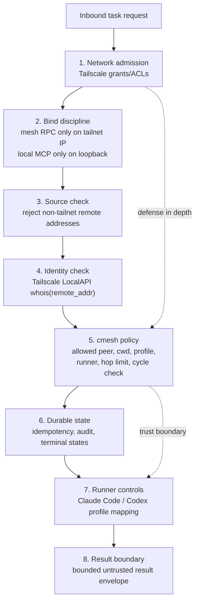

# Security

> Experimental: cmesh is not enterprise remote management software. It is an experimental agent delegation mesh for trusted private networks. Treat every worker profile as real authority on that machine.

cmesh is designed to be safe for personal and small-team tailnets when it is configured correctly. It does not rely on "the network can reach me" as permission to run code. Network reachability is only the first gate.

Short version:

- You provide trusted machines, Tailscale, and local runner credentials.
- Tailscale provides encrypted transport and authenticated peer identity.
- cmesh decides whether that peer may run this task, in this directory, with this profile.
- Worker output is treated as untrusted claims, not truth.
- Do not use cmesh on anything you love: machines, repos, credentials, or data you cannot afford to lose.

cmesh is not a sandbox by itself. It is a policy and delegation layer around local agent runners. The selected runner and operating system still matter.

## Defense in depth



The important line is between identity and authorization:

- Tailscale tells cmesh who connected.
- cmesh policy decides what that peer may do.

## How cmesh rejects illegitimate nodes

An illegitimate node can mean several different things. cmesh handles each layer differently.

### A machine not on your tailnet

It should not be able to reach the mesh port at all. Mesh RPC binds to the node's Tailscale IP, not `0.0.0.0`, and `cmesh doctor` verifies that bind behavior as part of the full setup check.

### A tailnet machine without cmesh permission

Even if Tailscale grants allow the connection, the worker daemon still calls Tailscale LocalAPI `whois(remote_addr)` and compares the resolved node identity against cmesh policy.

Example:

```toml
[policy]
allowed_peers = ["mac-studio"]
allowed_cwds = ["~/code/**"]
hop_limit = 2
```

If `random-laptop` is on the tailnet but not in `allowed_peers`, the task is denied before any runner starts.

Entries in `allowed_peers` must be the **whois-matchable identity** the resolver returns for the connection — the Tailscale DNS hostname label or the stable node ID — not a human display name. cmesh's onboarding and `repair_peers` write this identity for you; this is a deliberate constraint, since matching on a self-reported or display name would let an attacker-influenceable string into the trust boundary. A repair never trusts a peer's self-reported `/v1/hello` name for the allowlist; it anchors on `whois` and flags any disagreement instead of silently rewriting.

### A request with forged identity headers

cmesh does not trust identity headers. The loopback gateway rejects forwarded identity headers, and mesh RPC identity comes from Tailscale LocalAPI, not from `X-Forwarded-*`, bearer tokens, or request JSON.

### A direct mesh RPC request with forged origin fields

The worker treats `origin_node_id`, `provenance.origin_node_id`, and `delegation_chain` as claims that must be consistent with the whois-derived peer identity. A first-hop request is rejected if the claimed origin does not match the authenticated peer. A subdelegation request is rejected if the authenticated peer is not the last hop in the supplied chain.

Task lookup operations are scoped the same way: the original origin can fetch its task, and an intermediate worker can fetch the downstream task it directly created, but another tailnet peer cannot list, read, cancel, or fetch artifacts for tasks it does not own.

### A worker trying to forge delegation provenance

Subdelegation provenance is derived from a per-task token, not from model-supplied chain fields. When a worker task starts, cmesh writes a local task context, exposes a task token to that runner as `CMESH_TASK_TOKEN`, and registers a task-scoped cmesh MCP gateway for supported agent runners. Claude Code loads a strict task MCP config file; Codex ignores ambient user MCP config for that invocation and injects the local cmesh gateway with `bearer_token_env_var = "CMESH_TASK_TOKEN"`. MCP calls from the worker therefore carry the token structurally even when the gateway requires `host_token`.

Legacy provenance fields such as `origin_node_id`, `delegation_chain`, and `hop_count` are treated as compatibility hints only. They are ignored when a task token is present, and they are not authoritative for subdelegation policy. A local request without a valid task token is treated as a fresh local origin and does not inherit worker provenance.

### A valid peer asking for too much

A legitimate peer can still be denied. cmesh checks:

- peer identity;
- realpath-normalized cwd allowlist;
- requested profile;
- effective profile ceiling;
- runner availability;
- token-backed hop limit;
- token-backed cycle detection.

If any check fails, the task reaches a queryable terminal state such as `denied` or `failed`.

## What cmesh protects

cmesh protects the delegation boundary:

- who may ask this node to do work;
- where the work may run;
- which runner/profile may be used;
- whether a replayed request is identical or conflicting;
- whether every task has a durable state;
- whether task read/cancel/artifact operations are limited to the origin or direct requester;
- whether every dispatch, denial, result, and failure is auditable.
- whether subdelegation provenance is derived from stored task context instead of worker claims.

It also avoids common footguns:

- no remote MCP surface;
- no public internet listener;
- setup MCP uses local stdio only and can write config only after explicit confirmation;
- no daemon-to-daemon bearer token in Tailscale mode;
- no trust in forwarded identity headers;
- no silent task loss on restart;
- no automatic inlining of full transcripts into agent context;
- no long-lived task token after the worker reaches a terminal state.

## What cmesh does not protect by itself

cmesh is not a complete containment system.

It does not replace:

- Tailscale account security;
- operating system user separation;
- filesystem permissions;
- runner-specific sandboxing;
- secrets management;
- repository review;
- human judgment for risky changes.

If an allowed peer is compromised, cmesh can restrict the directories and profiles it may use, but it cannot make that peer trustworthy. Treat allowed peers as trusted-but-constrained machines.

## Is cmesh secure to use?

For a personal tailnet or trusted small-team tailnet, cmesh is designed to be reasonable to use when:

- mesh RPC binds only to the Tailscale IP;
- local MCP binds only to loopback;
- Tailscale LocalAPI works for the daemon user;
- `allowed_peers` is narrow;
- `allowed_cwds` is narrow;
- exposed profiles are conservative;
- risky profiles are used only on disposable or snapshot-protected machines;
- runner credentials are scoped appropriately;
- high-risk worker results are verified locally.
- `cmesh doctor runner <runner>` and `cmesh doctor service-context` pass under the same account or service user that runs the daemon.

For production or team-wide use, treat cmesh as security-sensitive infrastructure. Review policy, audit logs, runner manifests, OS permissions, and Tailscale grants before allowing broad access.

## Recommended hardening

### Tailscale

- Use Tailscale grants or ACLs to limit mesh RPC reachability to cmesh nodes.
- Prefer tagged devices for daemon nodes.
- Do not expose mesh RPC through Funnel, Serve, cloudflared, nginx, or a public load balancer.
- Run `cmesh doctor` under the same account or service user that runs cmesh.

### cmesh config

- Keep `allowed_peers` explicit.
- Keep `allowed_cwds` as narrow as practical.
- Prefer `query` for inspection tasks that fit deterministic cmesh probes.
- Use `readonly-agent` for open-ended read-only system or file inspection that does not fit a typed probe; it denies shell and writes by default.
- Profiles with `require_lease = true` require a worker-issued lease id. The worker validates the lease against the authenticated origin identity, requested profile, cwd scope, capability, expiry, and revocation state before accepting the task.
- Avoid network and git push claims unless a workflow truly needs them.
- Keep defaults strict: generated configs expose `query`; add `repo-dev` only when repo edits are needed.
- Add `query-network`, `query-shell`, `desktop-control`, `system-change`, `network`, `interactive`, or `git_push` profiles only as explicit opt-ins.
- Scope high-risk profiles with profile-level `allowed_peers`, usually to a single trusted origin such as your Mac.
- Require callers to request high-risk profiles by name; do not make them the runner default profile.
- For desktop control, elevation, browser automation, service changes, and other dangerous actions, prefer a Windows-side human approval loop over silent auto-approval.
- Keep hop limits low. The default is 2.
- Do not enable subdelegation casually.

### Runner setup

- Confirm the runner works locally before exposing it through cmesh.
- Use `cmesh install` to register the setup MCP into Claude Code or Codex before daemon setup when you want agent-assisted onboarding.
- Use bare or restricted profiles where practical.
- Do not configure cmesh to pass skip-all-permissions flags.
- Keep runner credentials local to the machine that uses them.

### Service credentials

Runner credentials are ambient authority for whatever OS account runs `cmesh up`. Claude Code subscription login state normally lives under that user's home directory, commonly below `.claude`; Codex login/config state likewise lives in the runner user's local config. API-key profiles may also read environment variables or configured key helpers. Protect those locations with OS account permissions and do not place runner auth in a broadly readable service environment.

Prefer a dedicated least-privilege service account for always-on workers. Give that account only the repository roots, toolchains, Tailscale LocalAPI access, and runner credentials needed by the profiles it exposes. If a human account is used on Windows to inherit existing Claude or Codex auth, treat that account as a standing remote-execution credential and keep `allowed_peers`, `allowed_cwds`, and risky profiles narrow.

When a workflow can use scoped credentials, prefer them over inherited auth: bare/API-key profiles with a constrained key helper, short-lived environment injection, or per-task credentials supplied by a wrapper. cmesh removes task tokens after terminal states, but it does not automatically rotate third-party runner credentials.

### Host security

- Run cmesh as a dedicated OS user where practical.
- Use filesystem permissions to limit what the daemon user can read or change.
- Put risky profiles on disposable or snapshot-protected machines.
- Review git branches produced by workers before merging.

## Known gaps

These are areas that still need hardening before cmesh should be treated as mature security infrastructure:

- No full OS sandbox wrapper yet for macOS Seatbelt, Linux systemd sandboxing, or Windows restricted users/job objects.
- Peer discovery is available for onboarding, but discovered peers are not trusted merely because they are visible. Keep generated policy narrow and review allowed peers.
- No per-human authorization layer for shared team tailnets.
- No remote interactive permission prompt forwarding.
- No signed runner manifest verification.
- No policy engine for prompt-content risk classification.
- No formal external security audit.

These gaps do not make the design pointless. They define the boundary: cmesh is a serious delegation control plane, but it should be deployed with conservative profiles and narrow policies until those layers mature.

## Security checklist

Before relying on a node as a worker:

- `cmesh doctor` passes.
- `cmesh doctor runner claude-code` or the configured runner equivalent passes.
- `cmesh doctor service-context` passes under the service account.
- Mesh RPC is reachable only on the Tailscale IP.
- MCP gateway is reachable only on loopback.
- Tailscale grants restrict `tcp:7778`.
- `allowed_peers` lists only intended origins.
- `allowed_cwds` does not include broad home or filesystem roots.
- Runner profiles honestly declare claims and gaps.
- Dirty worktrees are refused unless explicitly allowed.
- Audit logs are being written.
- You can retrieve task status and result after restarting the origin daemon.
- A different allowed peer cannot fetch or cancel another peer's task.

## See also

- [Architecture](architecture.md) — how the trust boundary is realized across the two MCP surfaces and the mesh RPC transport.
- [Tailscale grants](tailscale-grants.md) — the network-admission layer that sits in front of cmesh policy.
- [Configuration](configuration.md) — the policy, profile, and peer fields you tune to keep the boundary narrow.
- [Runner manifests](runner-manifests.md) — the evidence model that keeps profile claims honest.
